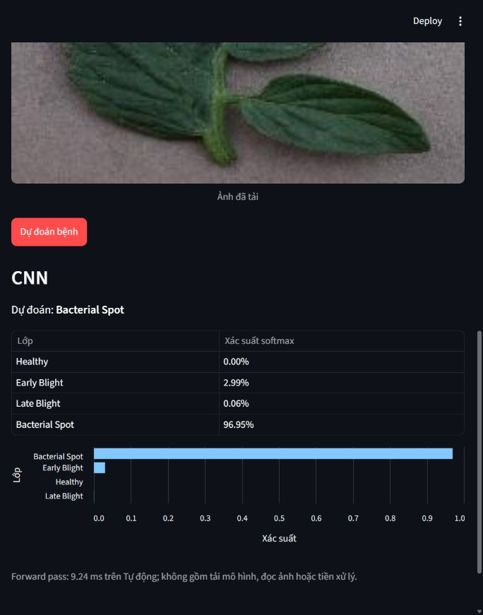
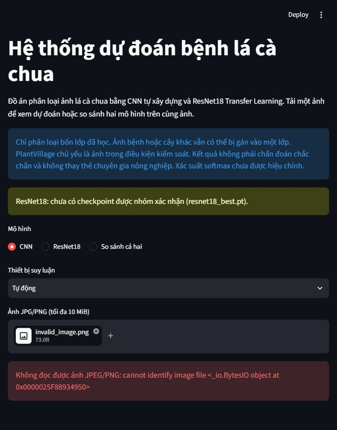
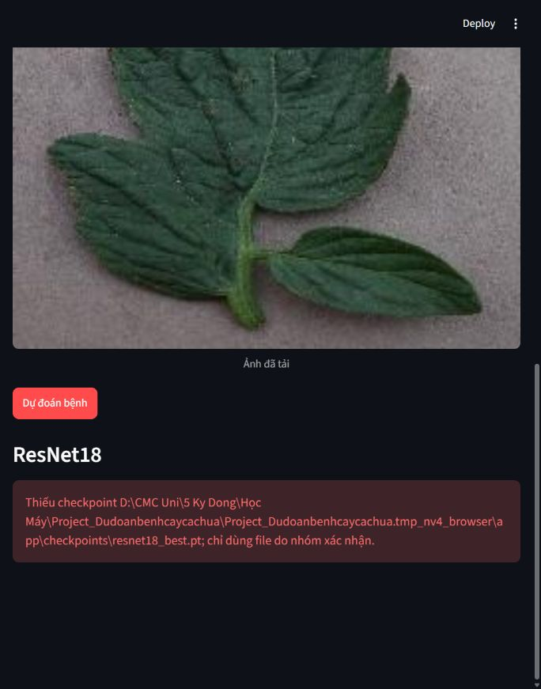

# Demo Streamlit – NV4 Nguyễn Minh Duy

## Trạng thái mới nhất: 30/10/2026

NV3 đã công bố [gói bàn giao ResNet18 trên PR #7](https://github.com/duyxl56785/Project_Dudoanbenhcaycachua/pull/7), gồm checkpoint fine-tuned, metadata, config, metrics và log. NV4 đã tải gói thật, đối chiếu SHA-256 và kiểm thử cục bộ cùng checkpoint CNN của PR #9. Hai PR vẫn chưa được merge; các tệp mô hình/checkpoint của NV2 và NV3 trong working tree NV4 chỉ là **bản tích hợp cục bộ, chưa stage hoặc push**. Để chạy trên máy khác cần lấy đúng các tệp bàn giao từ hai PR. Kết quả kiểm thử mới ở mục cuối tài liệu; những câu “ResNet18 chưa có checkpoint” trong nhật ký phía dưới mô tả trạng thái các ngày trước.

## Nhật ký trạng thái ngày 29/10/2026

Giao diện và API suy luận đã triển khai trên `feature/nv4-demo`; **Gate 4 chưa nghiệm thu**. PR [NV1 #8](https://github.com/duyxl56785/Project_Dudoanbenhcaycachua/pull/8) đã merge vào `main`. Dataset thật và checkpoint CNN của PR [NV2 #9](https://github.com/duyxl56785/Project_Dudoanbenhcaycachua/pull/9) đã được NV4 kiểm tra trong một bản tích hợp tạm trên CPU; PR #9 đã được NV5 approve nhưng vẫn mở và chưa merge. PR [NV3 #7](https://github.com/duyxl56785/Project_Dudoanbenhcaycachua/pull/7) đã được reviewer approve, nhưng chưa merge và chưa có checkpoint ResNet18 đã fine-tune. Vì vậy nhánh NV4 chưa chứa kiến trúc/checkpoint thật của hai mô hình và chế độ so sánh hai mô hình chưa thể nghiệm thu.

## Giới thiệu và luồng hoạt động

### Giao diện phiên đa ảnh

Sidebar chọn mô hình, thiết bị và hiển thị trạng thái checkpoint. Tab **Dự đoán** nhận tối đa **8 ảnh** JPG/JPEG/PNG, xem trước và chạy từng ảnh; một ảnh lỗi không chặn ảnh còn lại. Tab **Lịch sử phiên** giữ tên ảnh, thời điểm, mô hình, nhãn và xác suất trong `st.session_state`; không lưu nội dung ảnh vào lịch sử hay ghi file trên server. Có thể xem lại từng kết quả, tải CSV UTF-8 BOM cho Excel và xóa lịch sử. Tab **Thống kê phiên** đếm ảnh riêng biệt, lượt theo mô hình, nhãn được dự đoán và forward trung bình. Đây không phải tỷ lệ bệnh thực tế trong vườn.

Lịch sử cũng ghi trạng thái và thông báo cho ảnh hỏng hoặc mô hình thiếu checkpoint. Chỉ giữ 200 bản ghi mới nhất. CSV có 10 cột `timestamp`, `filename`, `model`, `predicted_class`, `top1_probability`, bốn xác suất theo thứ tự mapping và `status`; ô xác suất của lượt lỗi để trống. Tên file bắt đầu bằng ký tự công thức được vô hiệu hóa khi mở trong Excel. Dashboard có bộ lọc mô hình và đếm riêng lượt thành công/lỗi; thời gian forward trung bình chỉ tính trên lượt thành công.

Ở chế độ so sánh, kết quả CNN và ResNet18 nằm hai cột cho từng ảnh. Khi ResNet18 thiếu checkpoint, CNN vẫn cho kết quả thật và cột ResNet18 báo chưa sẵn sàng. Đổi danh sách ảnh, mô hình hoặc thiết bị sẽ xóa kết quả lượt hiện tại để tránh ghép nhầm. Trên màn hình hẹp, Streamlit tự xếp lại cột.

Với từng ảnh lá cà chua, demo xác minh nội dung JPEG/PNG, chuyển ảnh về RGB, áp dụng đúng transform Val/Test của mô hình, chạy forward pass trong `torch.inference_mode()`, rồi hiển thị nhãn top-1, bốn xác suất softmax và biểu đồ. Luồng chính:

`Upload → kiểm tra ảnh → RGB → transform NV1 → CNN/ResNet18 → logits 4 lớp → softmax → bảng/biểu đồ`

`demo/app.py` chỉ phụ trách giao diện. Mọi kiểm tra mapping, config, metadata, checkpoint và suy luận dùng chung `src/inference.py`, tránh để script và giao diện có hai pipeline khác nhau. Mô hình được cache theo tên, thiết bị và thời điểm sửa checkpoint; thay file trọng số sẽ làm cache hết hiệu lực.

## Bốn lớp đầu ra

Thứ tự cố định lấy từ `configs/class_mapping.json`, không sắp xếp theo alphabet:

| Chỉ số | Nhãn hiển thị |
|---:|---|
| 0 | Healthy |
| 1 | Early Blight |
| 2 | Late Blight |
| 3 | Bacterial Spot |

## Dataset đã xác minh trên máy NV4

- Nguồn nhóm: [Google Drive – ML_Tomato_Dataset/v1_manifests](https://drive.google.com/drive/folders/1gazFJNC1zdyAj8adjYeKTlOu1JJWIj7v), file `tomato_6502_images.zip`; nguồn gốc ảnh là [mohanty/PlantVillage](https://huggingface.co/datasets/mohanty/PlantVillage), cấu hình ảnh màu.
- ZIP được lưu cục bộ tại `data/tomato_6502_images.zip`, SHA-256 `303c77726cd56def12de4bec9a86517c6c65abd62b1dca8614f717fcfc227304`, kích thước 105.542.302 byte. ZIP và `data/raw/` đã được `.gitignore` loại khỏi commit.
- Ảnh giải nén nằm tại `data/raw/raw/color/`: **6.502 JPEG RGB 256×256**, gồm đúng bốn thư mục lớp. Train/Validation/Test giữ nguyên manifest: **4.115 / 1.031 / 1.356**.
- `python -m scripts.check_dataset --data-root data/raw --verify-hashes` đã đối chiếu thành công SHA-256 của cả 6.502 ảnh. Manifest có 6.502 path/hash duy nhất và không có path, SHA-256 hoặc `group_id` chồng lấn giữa các split theo quy tắc kiểm toán NV1. Pillow `verify()` đọc được toàn bộ ảnh.

Chuẩn bị lại dữ liệu trên máy khác:

```powershell
python -m scripts.prepare_dataset --archive data/tomato_6502_images.zip --data-root data/raw
python -m scripts.check_dataset --data-root data/raw --verify-hashes
```

## Cài đặt và chạy

`requirements.txt` đã liệt kê Streamlit, PyTorch, torchvision, Pillow và PyYAML. Môi trường `.venv` dựng từ file này đã được kiểm tra với Python 3.12.0, PyTorch 2.14.1+cpu, torchvision 0.29.1+cpu, Streamlit 1.66.1, Pillow 13.0.0 và PyYAML 6.0.3. CNN đã được xác minh end-to-end trong bản tích hợp tạm; nhánh NV4 hiện vẫn thiếu mã/checkpoint đã merge. Các lệnh cần chạy từ thư mục gốc dự án:

```powershell
python -m venv .venv
.venv\Scripts\Activate.ps1
python -m pip install -r requirements.txt
streamlit run demo/app.py
python -m unittest discover -s tests -v
```

## Tiền xử lý và mô hình

Val/Test và demo dùng pipeline tất định từ `build_val_transform(model_name, config)`: chuyển RGB, resize/crop theo YAML, chuyển tensor và normalize bằng đúng `mean/std` của checkpoint; không dùng augmentation Train. CNN PR #9 dùng ảnh đầu vào 224×224 và ImageNet mean/std. ResNet18 phải dùng config/metadata chính thức của NV3; các giá trị còn `null` không được tự suy đoán.

- **CNN tự xây dựng:** `build_model(num_classes=4)`, checkpoint thật PR #9, đã strict-load và suy luận CPU thành công.
- **ResNet18:** source PR #7 có `build_model(num_classes=4)` nhưng chưa có checkpoint fine-tuned. Demo chỉ báo thiếu checkpoint, tuyệt đối không chạy trọng số ngẫu nhiên như kết quả thật.

Để kiểm tra consistency CNN trong bản tích hợp tạm từ PR #9, cần lấy đồng bộ `src/models/cnn.py`, `src/cnn_training.py`, `scripts/infer_cnn.py`, `configs/cnn.yaml`, `checkpoints/cnn_best.pt` và `checkpoints/cnn_best.meta.json`. Riêng `src/cnn_training.py` là dependency của script NV2; thiếu file này sẽ gây `ModuleNotFoundError` dù API NV4 có thể strict-load checkpoint. Lần kiểm tra lại ngày 29/10/2026 với đúng bộ file trên và ảnh Bacterial Spot thật đạt `cnn: PASS; top-1=Bacterial Spot; max |delta|=0` trên CPU, SHA-256 checkpoint vẫn là `d33c95bb...f473a377390de1f`.

## Chuẩn bị checkpoint

Mỗi mô hình cần ba thành phần đồng bộ: kiến trúc `build_model(4)`, YAML preprocessing và cặp `checkpoints/<model>_best.pt` + `<model>_best.meta.json`. File `.pt` phải là plain tensor `state_dict`; app dùng `torch.load(..., map_location=device, weights_only=True)` và `load_state_dict(strict=True)`. Metadata phải chứa đúng bốn nhãn theo mapping chung và preprocessing giống YAML. Chỉ sử dụng checkpoint được chọn bằng `val_macro_f1`, không chọn bằng Test.

## Sử dụng giao diện và đọc kết quả

Upload tối đa 8 ảnh JPEG/PNG, mỗi ảnh tối đa **10 MiB**, xem trước, chọn CNN/ResNet18/so sánh cả hai trong sidebar, chọn thiết bị Tự động/CPU/CUDA rồi bấm **Dự đoán bệnh**. App hiển thị top-1, bảng và biểu đồ softmax bốn lớp theo thứ tự `configs/class_mapping.json` cho từng ảnh. Thời gian hiển thị chỉ đo forward pass, loại trừ tải mô hình, đọc ảnh và tiền xử lý; CUDA được đồng bộ trước và sau. Cache chỉ dùng lại mô hình khi file checkpoint không đổi. Softmax **không phải độ chắc chắn đã hiệu chỉnh**.

App kiểm tra nội dung ảnh, ảnh hỏng, giới hạn dung lượng, config/metadata, checkpoint và đầu ra logits. Khi thiếu checkpoint, app báo trước khi dự đoán; lỗi một mô hình không ngăn hiển thị kết quả mô hình còn lại trong chế độ so sánh. Chỉ đặt checkpoint do nhóm xác nhận tại `checkpoints/`. Checkpoint CNN hiện nằm trên nhánh NV2; PR #9 đã có approval nhưng chưa merge, nên checkpoint chưa được chép/commit vào NV4.

Nếu chưa tải ảnh mà bấm **Dự đoán bệnh**, app yêu cầu tải JPG/PNG. Khi thay ảnh hoặc đổi mô hình, kết quả cũ được xóa sau khi lần rerun hoàn tất. Xác suất hiển thị là softmax tương đối giữa đúng bốn lớp đã học, không phải độ tin cậy đã hiệu chỉnh hay xác suất chẩn đoán ngoài thực địa.

## Hợp đồng tích hợp

- NV1: `src.data.transforms.build_val_transform(model_name, config)` nhận `cnn` hoặc `resnet18`, trả callable ảnh PIL RGB → tensor CHW bằng pipeline Val/Test tất định. Config chính thức phải điền `image_size`, `normalize_mean`, `normalize_std`; ResNet18 cần thêm `resize_size`. Không dùng augmentation Train.
- NV2/NV3: `src.models.<name>.build_model(num_classes=4)` tạo đúng kiến trúc **không tải pretrained weights trong inference**. NV4 vẫn hỗ trợ `build_resnet18(num_classes=4, pretrained=False)` để tương thích phiên bản cũ của PR #7. Checkpoint `checkpoints/cnn_best.pt` / `checkpoints/resnet18_best.pt` phải là plain tensor `state_dict` load bằng `torch.load(..., weights_only=True)` và `load_state_dict(strict=True)`. Metadata/config lưu riêng; `<model>_best.meta.json` là bắt buộc để app kiểm nhãn và preprocessing khớp. Thứ tự logits luôn 0..3 theo mapping chung.
- Chọn checkpoint bằng `val_macro_f1` cao nhất, hòa thì `val_loss` thấp hơn; không dùng Test để chọn. Cần log Validation/commit/hash checkpoint để chứng minh, không suy ra từ tên file.

API: `predict_bytes(data, model_name, root=ROOT, device="cpu")` hoặc `predict_image(image, model_name, root=ROOT, device="cpu")`. `device="auto"` chọn CUDA khi khả dụng, nếu không thì CPU. `predict(...)` nhận model/transform để unit test; mô hình giả trong unit test không chứng minh tích hợp thật.

## Kiểm thử và bàn giao cho NV5

Đã chạy trong `.venv`: `python -m pytest tests -q` → **34 passed, 19 subtests passed**. `python -m compileall -q src demo tests` và `git diff --check` đạt. Streamlit khởi động thành công ở `127.0.0.1`; sau khi kiểm thử server đã được dừng.

Kiểm thử CNN thật dùng checkpoint từ head PR #9 trong bản sao tạm, không sửa nhánh NV2 và không đưa checkpoint vào commit NV4. Checkpoint có SHA-256 `d33c95bbe15e82fa83f1fd954136ebfff6e1cbba1a86fe40af473a377390de1`, metadata epoch 24, Validation macro-F1 0,976836. Trên ảnh Test nhãn Bacterial Spot `00416648-...3110.JPG` (SHA-256 `3320c467...db06`), `demo.check_consistency` xác nhận top-1 và cả bốn softmax của script NV2/API NV4 khớp tuyệt đối (`max |delta| = 0`) trên CPU. Đánh giá lại toàn bộ 1.356 ảnh Test trên CPU cho Accuracy **0,969764** và macro-F1 **0,965034**, khớp file kết quả NV2. Đây là kiểm chứng tái lập kỹ thuật của checkpoint đã chốt bằng Validation, không phải lựa chọn mô hình bằng Test.

Kiểm thử trình duyệt tự động cũng dùng đúng bản tích hợp tạm nói trên và một ảnh Test thật. Ảnh xem trước hiển thị đúng; chọn CNN rồi bấm **Dự đoán** trả về `Bacterial Spot` cùng đủ bốn xác suất: Healthy 0,00%, Early Blight 2,99%, Late Blight 0,06%, Bacterial Spot 96,95%. File PNG giả nội dung ảnh hỏng được từ chối với thông báo không đọc được ảnh. Khi chọn ResNet18, app báo đúng `Thiếu checkpoint ... resnet18_best.pt`; thứ tự kiểm tra trong `src/inference.py` đã được sửa để lỗi thiếu checkpoint không bị che bởi config preprocessing chưa hoàn thiện, kèm regression test.

### Kết quả trình duyệt trên bốn lớp

Mỗi ảnh dưới đây là ảnh đầu tiên của lớp tương ứng trong split Test chính thức. Xác suất được ghi đúng như giao diện, kể cả trường hợp dự đoán sai.

| Ảnh Test | Nhãn thật | Nhãn CNN | Healthy | Early Blight | Late Blight | Bacterial Spot | Kết quả |
|---|---|---|---:|---:|---:|---:|---|
| `00bce074-...0223.JPG` (`41ae744b...a014`) | Healthy | Healthy | 99,97% | 0,00% | 0,03% | 0,00% | Đúng |
| `0012b9d2-...8389.JPG` (`29b79036...6123`) | Early Blight | Late Blight | 0,04% | 41,74% | 58,16% | 0,07% | Sai |
| `005e3b43-...5104.JPG` (`a9eebda1...49a3`) | Late Blight | Late Blight | 0,05% | 7,43% | 92,48% | 0,04% | Đúng |
| `00416648-...3110.JPG` (`3320c467...db06`) | Bacterial Spot | Bacterial Spot | 0,00% | 2,99% | 0,06% | 96,95% | Đúng |

Ảnh Early Blight bị nhầm thành Late Blight ở biên khá gần. Kết quả này phù hợp với báo cáo NV2: phần lớn lỗi Test là nhầm Early Blight ↔ Late Blight; đây không phải lỗi mapping hay giao diện. Đổi ảnh liên tiếp xóa kết quả cũ; chạy bốn ảnh liên tiếp cho cache `hits=3, misses=1`, chứng minh cùng checkpoint chỉ nạp một lần trong tiến trình API.

### Ma trận kiểm thử đầu vào và chuyển mô hình

| Trường hợp | Kết quả thực tế |
|---|---|
| Chưa upload rồi bấm dự đoán | Báo “Vui lòng tải ảnh JPG hoặc PNG…”; không traceback |
| TXT đổi tên `.jpg`, PNG hỏng | Bị Pillow từ chối; không có kết quả cũ |
| File rỗng | Báo ảnh trống hoặc vượt giới hạn |
| GIF | Bộ upload từ chối `image/gif`; không vào pipeline |
| File 10 MiB + 1 byte | Báo vượt giới hạn 10 MiB |
| Grayscale, RGBA | Chuyển RGB, preview và suy luận thành công |
| Ảnh 91×37 | Preview và suy luận thành công; transform resize về 224×224 |
| Chọn ResNet18 | Báo thiếu `resnet18_best.pt`, không dùng trọng số ngẫu nhiên |
| So sánh cả hai | CNN vẫn hiển thị kết quả; ResNet18 báo thiếu checkpoint riêng |
| Đổi CNN/ResNet18/so sánh và chạy lặp | Không crash; trạng thái kết quả được làm mới |

ResNet18 từ head PR #7 đã nhận batch ảnh thật `[1,3,224,224]` và trả logits hữu hạn `[1,4]` với `pretrained=False`; đây chỉ là kiểm thử kiến trúc khởi tạo ngẫu nhiên. Chưa có checkpoint ResNet18 thật nên chưa chạy suy luận/đánh giá ResNet18 và chưa chạy `demo.check_consistency --model both`.

### Ảnh bằng chứng demo thật

Giao diện đa ảnh và dashboard sau khi chạy CNN thật: [so sánh đa ảnh](../demo/screenshots/multi_image_compare.jpg), [thống kê phiên](../demo/screenshots/dashboard_multi_image.jpg).

Kiểm thử lại ngày 28/10/2026 với checkpoint CNN SHA-256 `d33c95bb...f473a377390de1f`: tải ảnh Bacterial Spot và Healthy thật cùng `corrupt.jpg`. Hai ảnh được CNN dự đoán đúng, ảnh hỏng bị từ chối riêng; lịch sử ghi đủ hai lượt thành công và một lượt lỗi, nút CSV tải file thành công, dashboard hiển thị 2 ảnh/2 lượt thành công/1 lỗi. Chọn ResNet18 cho cùng ảnh hiển thị trạng thái thiếu checkpoint, không tạo dự đoán. Xóa lịch sử trong phiên đã xác nhận trạng thái trống. [Preview đa ảnh và lỗi](../demo/screenshots/preview_batch_error_20261028.jpg), [lịch sử và CSV](../demo/screenshots/history_csv_20261028.jpg), [dashboard có lượt lỗi](../demo/screenshots/dashboard_error_20261028.jpg).

**Video demo chưa được quay.** [Kịch bản và danh sách thao tác](DEMO_SCRIPT_NV4.md) đã cập nhật để quay màn hình thật khi nhóm chốt bản trình bày.

Các ảnh dưới đây được chụp trực tiếp từ phiên Streamlit kiểm thử, không phải ảnh dựng. Chúng là bằng chứng hành vi giao diện; số liệu đánh giá tập Test vẫn lấy từ phép kiểm thử tái lập nêu trên.







NV5 có thể dùng phần mô tả chức năng, cách chạy, giới hạn và ảnh bằng chứng ở đây cho báo cáo. PlantVillage chủ yếu là ảnh trong điều kiện kiểm soát; ảnh cây/bệnh khác vẫn bị ép vào một trong bốn lớp. Không dùng demo để khẳng định chẩn đoán chắc chắn hay phát hiện sớm.

### Bàn giao dùng ngay cho NV5

| Nội dung | Nguồn kiểm chứng | Cách sử dụng trong báo cáo |
|---|---|---|
| Giao diện CNN, đa ảnh, lỗi, lịch sử, dashboard | Ảnh thật trong `demo/screenshots/` và bảng kiểm thử trình duyệt ở trên | Minh họa luồng sử dụng và xử lý lỗi; không gọi ảnh demo là phép đánh giá Test toàn tập. |
| CNN Test Accuracy 0,969764; macro-F1 0,965034 | Checkpoint/metrics PR #9, phép đánh giá lại 1.356 ảnh đã ghi ở trên | Ghi rõ nguồn PR #9 và kết quả NV4 tái lập; NV5 có phép đối chiếu độc lập ở PR #11. |
| ResNet18 | PR #7 chỉ có mã kiến trúc, chưa có checkpoint fine-tuned | Để trạng thái chờ; không lập bảng so sánh định lượng hoặc gắn ảnh thiếu checkpoint thành kết quả mô hình. |
| Video | `docs/DEMO_SCRIPT_NV4.md` là kịch bản; hiện chưa có tệp video | Có thể dùng ảnh chụp thật; chưa ghi “đã quay video”. |

Workflow `.github/workflows/nv4-demo-ci.yml` chỉ chạy khi PR có head `feature/nv4-demo` và thay đổi file NV4. Nó chạy `compileall` và `pytest tests -q` trên CPU với checkout sạch, không cần ảnh dataset, checkpoint hay GPU. Kiểm thử cục bộ trên checkout sạch đạt **34 passed, 19 subtests passed**; trạng thái GitHub Actions phải kiểm tra riêng sau mỗi push.

### Kiểm thử liên nhánh ngày 29/10/2026

Trong worktree tạm từ `main`, NV4 lần lượt ghép head PR #10 (NV1), #9 (NV2), #7 (NV3), #1 (NV4) và #11 (NV5), **không merge vào `main` hoặc branch thành viên**. Cả năm phép merge đều không xung đột. PR #10 chỉ sửa phần trực quan hóa và test dữ liệu, không đổi `src/data/dataset.py` hay `src/data/transforms.py`; trên bản ghép, `scripts.check_dataset --data-root <data/raw thật>` đạt với split 4.115/1.031/1.356. CNN checkpoint PR #9 strict-load và `demo.check_consistency --model cnn` đạt `max |delta|=0` trên ảnh Bacterial Spot thật. Streamlit bản ghép đã upload hai ảnh thật và một ảnh hỏng, dự đoán CNN đúng Bacterial Spot/Healthy, ghi lỗi ảnh hỏng riêng, xuất CSV, hiển thị dashboard 2 ảnh/2 lượt thành công/1 lỗi và thông báo ResNet18 thiếu checkpoint trong chế độ so sánh. [Ảnh kiểm thử tích hợp thật](../demo/screenshots/integration_cnn_resnet_missing_20261029.jpg).

**Cập nhật 30/10/2026 — blocker test liên nhánh đã được NV2 sửa:** Bản ghép trước đó dừng ở ba lỗi `ModuleNotFoundError: nv2_helpers` vì PR #11 thêm `tests/__init__.py`, còn ba test NV2 import helper ở cấp gốc. NV2 đã đẩy commit `5d363f5` trên PR #9, đổi cả ba import thành `from tests.nv2_helpers import ...`. NV4 ghép lại head mới của PR #10/#9/#7/#1/#11 từ `main`, không áp dụng patch thử và không đặt `PYTHONPATH`; lệnh chuẩn `python -m pytest tests -q` đạt **79 passed, 1 skipped, 19 subtests passed**. [Traceback lịch sử và đối chiếu bản sửa](audits/NV4_INTEGRATION_PYTEST_20261029.md). Chỉ cần review/merge theo quy trình nhóm; không còn blocker collection này trên bản ghép hiện tại.

### Chạy CNN thật cục bộ trước khi PR #9 merge (30/10/2026)

NV4 tạo worktree cục bộ `../cnn_demo_local` từ head `feature/nv4-demo`, rồi lấy riêng sáu tệp đồng bộ của PR #9 (`src/models/cnn.py`, `src/cnn_training.py`, `scripts/infer_cnn.py`, `configs/cnn.yaml`, `checkpoints/cnn_best.pt`, `checkpoints/cnn_best.meta.json`) vào đó để kiểm thử độc lập. Máy NV4 đã có một Streamlit server chạy từ thư mục repo gốc trên `localhost:8501`; để chính URL này nhận CNN, NV4 chép cùng sáu tệp đã xác minh vào working tree gốc **chỉ ở trạng thái cục bộ, chưa stage/commit**. Không merge PR #9, không đổi branch NV2 và không push mã/checkpoint NV2 từ branch NV4. Khi PR #9 được tích hợp chính thức, đối chiếu hoặc dọn các tệp cục bộ trước khi pull/merge.

Checkpoint cục bộ có SHA-256 `d33c95bbe15e82fa83f1fd954136ebfff6e1cbba1a86fe40af473a377390de1f` (1.571.893 byte). `torch.load(weights_only=True)` + `load_state_dict(strict=True)` trên CPU đạt; model ở chế độ `eval()`. RGB và `build_val_transform('cnn', config)` tạo tensor `[1,3,224,224]`; logits `[1,4]` hữu hạn, tổng bốn xác suất xấp xỉ 1. Metadata và mapping khớp thứ tự `Healthy`, `Early Blight`, `Late Blight`, `Bacterial Spot`. Trên bốn ảnh dataset thật, Bacterial Spot/Healthy/Late Blight được dự đoán đúng; mẫu Early Blight đã thử bị nhầm Late Blight (58,16%), giữ nguyên kết quả. `python -m demo.check_consistency <ảnh Bacterial Spot> --model cnn` đạt `max |delta|=0`.

Từ repo gốc (hoặc worktree cục bộ nếu chưa có server), dùng Python của `.venv` dự án để chạy `python -m streamlit run demo/app.py --server.port=8501`. Ngày 30/10, cả `http://localhost:8501` từ repo gốc và `http://127.0.0.1:8501` từ worktree đều trả health `200 ok`, sidebar báo CNN có checkpoint. Trình duyệt trên **đúng URL `localhost:8501`** upload ảnh Bacterial Spot thật, preview và dự đoán đúng **Bacterial Spot 96,95%** với đủ bốn xác suất. Multi-image, lịch sử, dashboard, tải CSV và thông báo thiếu checkpoint ResNet18 đã kiểm tra. [Ảnh chụp trình duyệt thật trên localhost](../demo/screenshots/cnn_local_checkpoint_20261030.jpg). Bộ test NV4 ở cả worktree và repo gốc đạt **34 passed, 19 subtests passed**; `compileall` và `git diff --check` đạt.

## Lỗi thường gặp và cách khắc phục

| Thông báo | Nguyên nhân | Cách xử lý |
|---|---|---|
| `Thiếu checkpoint ...` | Chưa đặt trọng số được xác nhận | Lấy checkpoint từ PR/commit chính thức; không tạo file giả |
| `Thiếu metadata ...` | Thiếu sidecar hoặc bàn giao chưa đủ | Đặt `.meta.json` cạnh checkpoint |
| `preprocessing chưa chốt` | YAML còn `null` | Người phụ trách mô hình chốt config và metadata cùng nhau |
| `thứ tự nhãn khác` / `preprocessing khác` | Checkpoint không đồng bộ cấu hình | Dùng đúng cặp checkpoint–metadata–YAML |
| `Không tải được checkpoint` | File hỏng, sai kiến trúc/số lớp/định dạng | Kiểm tra SHA-256, `build_model(4)` và plain `state_dict` |
| `CUDA chưa khả dụng` | Máy không có CUDA phù hợp | Chọn CPU hoặc Tự động |
| Không đọc được ảnh | Nội dung không phải JPEG/PNG hoặc file hỏng | Xuất lại ảnh hợp lệ, không chỉ đổi phần mở rộng |

## Giới hạn

- Chỉ phân loại bốn lớp đã học; không có lớp “khác/không biết”.
- PlantVillage chủ yếu chụp trong điều kiện kiểm soát, chưa chứng minh độ chính xác ngoài đồng ruộng.
- Softmax chưa hiệu chỉnh; không thay thế chuyên gia nông nghiệp.
- CNN đã được kiểm thử thật nhưng PR #9 chưa merge. ResNet18 chưa có checkpoint fine-tuned nên chưa thể so sánh hai mô hình hoặc nghiệm thu Gate 4.

## Nghiệm thu VI.4

- [x] App khởi động trong `.venv` dựng từ `requirements.txt`; trình duyệt đã tự động upload/xem trước ảnh thật, chọn CNN, dự đoán và hiển thị đủ bốn xác suất.
- [x] Load cả hai checkpoint thật trên CPU trong bản tích hợp cục bộ; checkpoint vẫn thuộc PR #9 và gói bàn giao PR #7, chưa merge vào nhánh NV4.
- [x] Mapping, preprocessing và kết quả script khớp trên ảnh Bacterial Spot thật với cả CNN và ResNet18; xem kết quả kiểm thử ngày 30/10 bên dưới.
- [x] UI xử lý ảnh lỗi, thiếu checkpoint và hiển thị hạn chế; ảnh hỏng và ResNet18 thiếu checkpoint đã được xác minh trực tiếp trong trình duyệt.

### Tích hợp checkpoint ResNet18 thật ngày 30/10/2026

- Nguồn: [PR NV3 #7](https://github.com/duyxl56785/Project_Dudoanbenhcaycachua/pull/7), gói `NV3_ResNet18_HANDOFF_20261030.zip` tại [Google Drive do NV3 công bố](https://drive.google.com/file/d/153DOn8zLCiIhnydLoPNDcht3X0EFhKuR/view). Branch NV3 HEAD lúc kiểm tra: `e8b0e6fe326de78c11d0993ceb8a55ef4abeb8e0`. PR/Issue #4 vẫn cần quy trình review/merge của nhóm.
- Checkpoint trong ZIP: `checkpoints/resnet18_best.pt`, 44.794.251 byte; SHA-256 tính độc lập **`61d44ba8ac02ee57c44cbd3835aaac2c657c97924735fea743a60df5f5fdf9e2`**, trùng `CHECKPOINT_SHA256.txt` và PR #7. Sidecar xác nhận `stage=fine_tuning`, epoch 9, Validation macro-F1 **0,9808585369**, `val_loss=0,0483145519`, ImageNet `IMAGENET1K_V1` làm điểm khởi tạo. Số liệu Test trong gói do NV3 báo: 1.356 ảnh, Accuracy **0,9867256637**, macro-F1 **0,9839779476**; NV4 chưa chạy lại toàn bộ Test cho ResNet18.
- NV4 lấy đúng `src/models/resnet18.py`, `src/resnet18_workflow.py`, `scripts/infer_resnet18.py`, `configs/resnet18.yaml` từ branch NV3 và cặp checkpoint/metadata từ ZIP vào working tree cục bộ. Không merge PR, không sửa branch NV3, không commit trọng số hoặc mã NV3 vào PR #1. `torch.load(weights_only=True)` và `load_state_dict(strict=True)` thành công trên CPU; model `eval()`, tensor `[1,3,224,224]`, logits `[1,4]`. Thứ tự nhãn đúng `Healthy`, `Early Blight`, `Late Blight`, `Bacterial Spot`; Val/Test transform là resize cạnh ngắn 256, center crop 224, ImageNet mean/std.
- Bốn ảnh thật, mỗi lớp một ảnh: `000146ff...259.1.JPG` Healthy → Healthy (**99,9775%**); `0012b9d2...8389.JPG` Early Blight → Early Blight (**99,9882%**); `0003faa8...4946.JPG` Late Blight → Late Blight (**99,3301%**); `00416648...3110.JPG` Bacterial Spot → Bacterial Spot (**67,1089%**). Chi tiết xác suất theo thứ tự bốn nhãn cho ảnh Bacterial Spot: **0,0783% / 25,5758% / 7,2370% / 67,1089%**. Đây là kiểm thử mẫu, không phải phép đo accuracy toàn tập.
- `python -m demo.check_consistency "data/raw/raw/color/Tomato___Bacterial_spot/00416648-be6e-4bd4-bc8d-82f43f8a7240___GCREC_Bact.Sp 3110.JPG" --model both`: CNN **PASS**, ResNet18 **PASS**, `max |delta|=0` cho cả hai. `python -m pytest -q`: **34 passed, 19 subtests passed**. `compileall` và `git diff --check` đạt.
- Streamlit mở được trên `http://127.0.0.1:8501/`; giao diện báo cả hai checkpoint sẵn có và xem trước hai ảnh thật. Trình duyệt đã chọn ResNet18, dự đoán ảnh Bacterial Spot **Bacterial Spot 67,11%** và ảnh Healthy **Healthy 99,98%**, mỗi ảnh có đủ bốn xác suất. Chế độ so sánh chạy CNN và ResNet18 song song trên hai ảnh, không có lỗi. [Ảnh ResNet18 thật](../demo/screenshots/resnet18_real_20261030.jpg) và [ảnh so sánh thật](../demo/screenshots/cnn_resnet18_compare_20261030.jpg). Các ảnh cũ có thông báo thiếu checkpoint chỉ phản ánh thời điểm trước NV3 bàn giao.

Lệnh chạy sau khi lấy đúng bộ tệp của hai PR:

```powershell
.venv\Scripts\python.exe -m streamlit run demo/app.py --server.port 8501
.venv\Scripts\python.exe -m demo.check_consistency "data/raw/raw/color/Tomato___Bacterial_spot/00416648-be6e-4bd4-bc8d-82f43f8a7240___GCREC_Bact.Sp 3110.JPG" --model both
```
